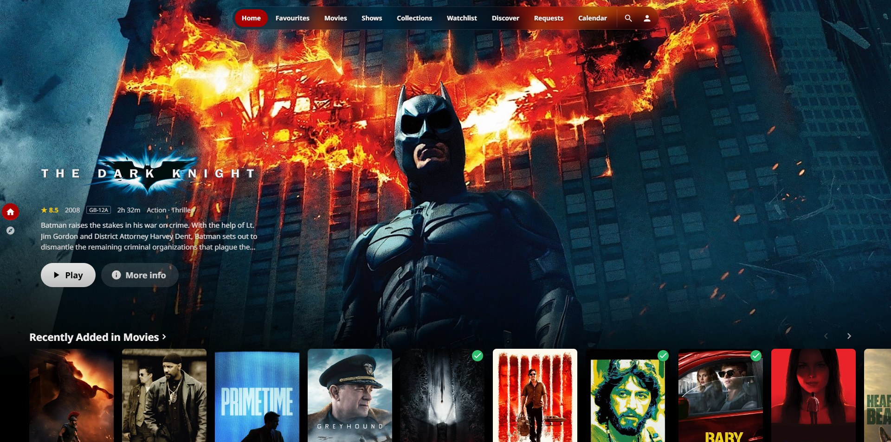
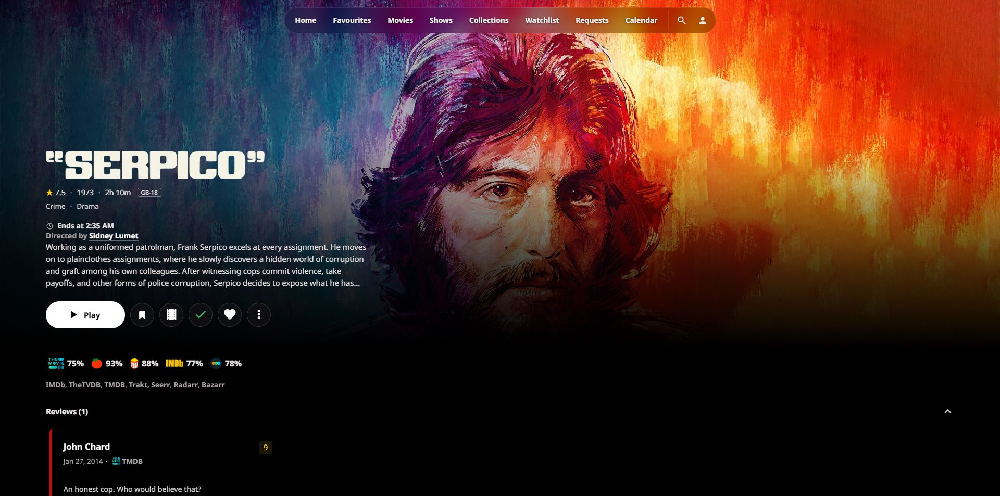
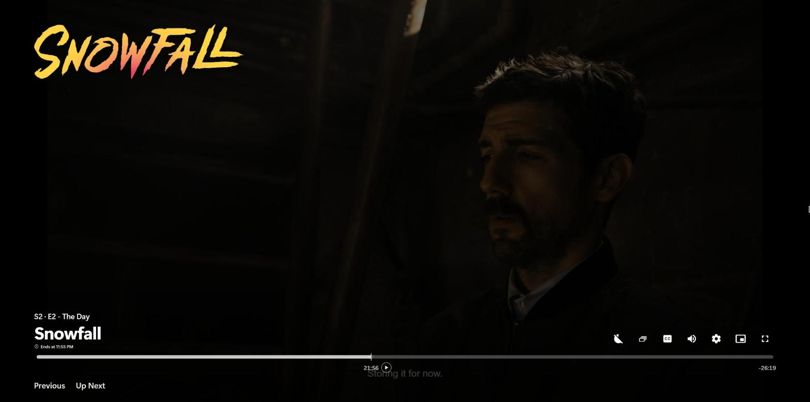
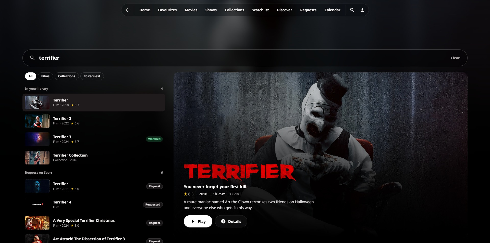

<div align="center">


Restyles the **Jellyfin 12** web client and rebuilds its pages, from Home to the video player.

[](https://github.com/stackinnnn/crimson-noir/releases/latest)

[](LICENSE)

[Now&nbsp;showing](#now-showing-home) &nbsp;·&nbsp; [Scenes](#scenes-page-by-page) &nbsp;·&nbsp; [**Admission&nbsp;(install)**](#admission-install-from-the-plugin-catalog) &nbsp;·&nbsp; [Running&nbsp;notes](#running-notes-compatibility) &nbsp;·&nbsp; [End&nbsp;credits](#end-credits)

</div>

## Now showing: Home



A slideshow you can drag, a backdrop that follows the slide, and your accent colour throughout. Everything stays black, so the artwork does the talking.

## Scenes: page by page

### Film pages



The title's logo over its artwork, with rating, runtime, when it ends, who directed it and the synopsis, then Play and the rest of the actions in one row. Ratings and reviews follow below. *(The ratings row and reviews need Jellyfin Enhanced.)*

### The player



Pause and the picture dims behind the show's logo. Clean episode titles, a playhead that shows the time, Skip Intro with a countdown, and Previous / Up Next.

### Your accent, your settings


The profile button opens quick settings: eight accent colours or your own, backdrops on or off, and titles that only appear on hover.

### Collections, on a shelf


Box sets open as a row of spines. Pick a film and its backdrop, logo and details take the stage.

### Seasons with synopses


Numbered episodes with stills, runtime, rating, air date and a two-line synopsis, plus a watched toggle on every row.

### Libraries with feature tiles


Movies, Shows and Collections get a clear title and count, and wide feature tiles (unwatched picks, top genres) break up the grid.

### People as a career timeline


Portrait, age and birthplace, awards, and everything they've made that's in your library, laid out by year.

### Search: list and preview



Results from your library and from Jellyseerr side by side, with a large preview and a Request button for anything you don't have. *(Jellyseerr results need Jellyfin Enhanced.)*

### Watchlist: ready to watch


Shows with new episodes, films and box sets you've saved, each with Play right on the artwork. *(Needs KefinTweaks.)*

### Calendar: next up and the week


The next thing to air, large, then the week ahead with episode, cinema and digital releases. *(Needs Jellyfin Enhanced.)*

### Requests: list and detail


Every Jellyseerr request with its status, and the details for the one you pick. *(Needs Jellyfin Enhanced.)*

## Admission: install from the plugin catalog

**Before you start:** you need Jellyfin **12**. Crimson Noir adds itself to Jellyfin Web through the **File Transformation** plugin, which you install alongside it below. Optional: **Jellyfin Enhanced** (Calendar, Requests, Jellyseerr search) and **KefinTweaks** (Watchlist); pages whose plugin isn't installed simply don't appear.

1. Open **Dashboard → Plugins → Repositories** and add two repositories:
   - Name `File Transformation`, URL:
     ```
     https://www.iamparadox.dev/jellyfin/plugins/manifest.json
     ```
   - Name `Crimson Noir`, URL:
     ```
     https://raw.githubusercontent.com/stackinnnn/crimson-noir/main/manifest.json
     ```
2. In **Catalog**, install **File Transformation** and **Crimson Noir**.
3. **Restart Jellyfin**, then reload your browser with <kbd>Ctrl</kbd>+<kbd>Shift</kbd>+<kbd>R</kbd>.

Updates arrive through the catalog like any other plugin.

**Settings.** *Dashboard → Crimson Noir* has two switches: **Enable the theme** (back to stock Jellyfin without uninstalling) and **Jellium Desktop support**. Each person picks their accent colour, backdrops and "titles on hover" from the profile button, top right.

<details>
<summary><b>Moving from a manual install</b></summary>

If you pasted Crimson Noir into Jellyfin by hand before, remove that copy after installing the plugin so the theme doesn't load twice:

- **Dashboard → General → Branding**: clear **Custom CSS**.
- **Dashboard → JavaScript Injector**: disable or delete the `Crimson Noir`, `Slideshow JS` and `Jellium mpv bridge` entries.

</details>

<details>
<summary><b>Manual install (without the plugin)</b></summary>

1. **Dashboard → General → Branding**: paste `css/crimson-noir.css` into **Custom CSS**.
2. Install the [JavaScript Injector](https://github.com/n00bcodr/Jellyfin-JavaScript-Injector) plugin and add an entry with `js/crimson-noir.js`. Add `js/jellium-mpv-bridge.js` too if you use Jellium Desktop.
3. Reload with <kbd>Ctrl</kbd>+<kbd>Shift</kbd>+<kbd>R</kbd>.

</details>

## Running notes: compatibility

The theme needs a modern browser engine, with CSS `:has()` and `color-mix()`: Chrome or Edge 111+, Safari 16.4+, Firefox 121+. In anything older it **switches itself off**, so you get working stock Jellyfin instead of a broken page.

| Client | Status | Notes |
| --- | --- | --- |
| Chrome, Edge | **Works** | Main development browser |
| Firefox, Zen | **Works** | Used with Zen |
| [Jellium Desktop](https://github.com/andrewrabert/jellium-desktop) | **Works** | Keep *Jellium Desktop support* on. Menus use smoked glass, because mpv's picture can't be blurred. |
| Safari 16.4+ (macOS, iOS, iPadOS) | Untested | Every feature it uses is supported; not yet checked on a device |
| Jellyfin Media Player 1.x | Stock look | Its Chromium 83 engine is too old, so it shows stock Jellyfin |
| Jellyfin for Android and iOS (phone apps) | Emulated | These apps show your server's web interface, so they get the theme. Checked at phone size with Jellyfin's mobile layout (Home, shows, libraries, search, profile panel); not yet on a real phone. iOS needs iOS 16.4+. |
| webOS and Tizen TVs | Emulated | These run the web interface in Jellyfin's TV layout. Checked at 1920×1080: pages scale up cleanly. Remote (D-pad) navigation not yet tried on a real TV. |
| Android TV app, Swiftfin, Findroid, Roku | No theme | Fully native apps; they don't use the web interface, so web themes can't reach them. |

**Bugs and ideas:** [open an issue](../../issues/new/choose). The form asks for the page, your client, the steps, any console errors (F12 → Console) and a screenshot.

## Behind the scenes

```
css/crimson-noir.css              the theme's styles
js/crimson-noir.js                the theme script
js/crimson-noir-guard.js          switches the theme off in browser engines that are too old
js/jellium-mpv-bridge.js          Jellium Desktop support
js/slideshow.js                   older build, kept for manual installs that still use it
src/Jellyfin.Plugin.CrimsonNoir/  the plugin, which embeds the files above
scripts/pull.ps1, push.ps1        sync a manual install (they refuse servers running the plugin)
```

- **Build:** every push compiles the plugin and syntax-checks the scripts on GitHub Actions.
- **Release:** go to **Actions → Release → Run workflow**, then enter a version (e.g. `1.0.3.0`) and what changed. It builds the zip, publishes the release and adds it to `manifest.json`, so servers see the update in their catalog.
- The history before 16 November 2026 was rebuilt from dated theme backups.

## End credits

- Plugin structure and the File Transformation approach adapted from [SleekFin](https://github.com/varunaditya-plus/SleekFin) by varunaditya-plus (MIT), which also informed the Jellyfin 12 page hooks.
- [File Transformation](https://github.com/IAmParadox27/jellyfin-plugin-file-transformation) by IAmParadox27.
- Works alongside Jellyfin Enhanced and JavaScript Injector by n00bcodr, and KefinTweaks by ranaldsgift.

Released under the [MIT licence](LICENSE).
