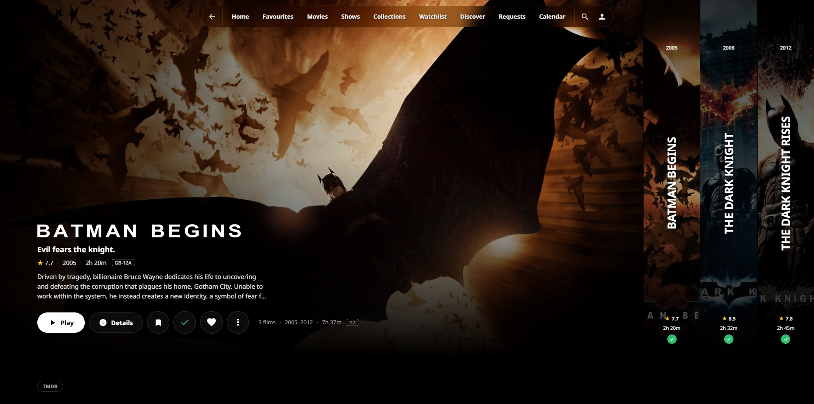
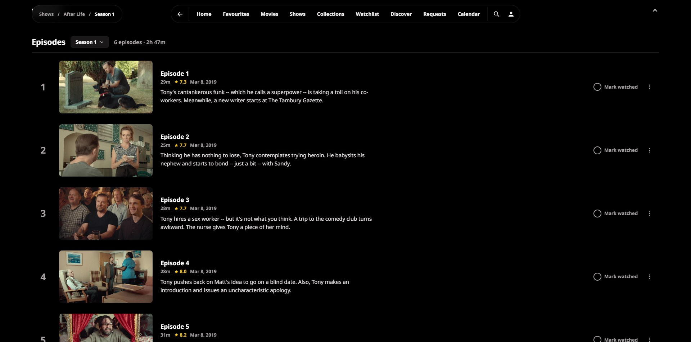
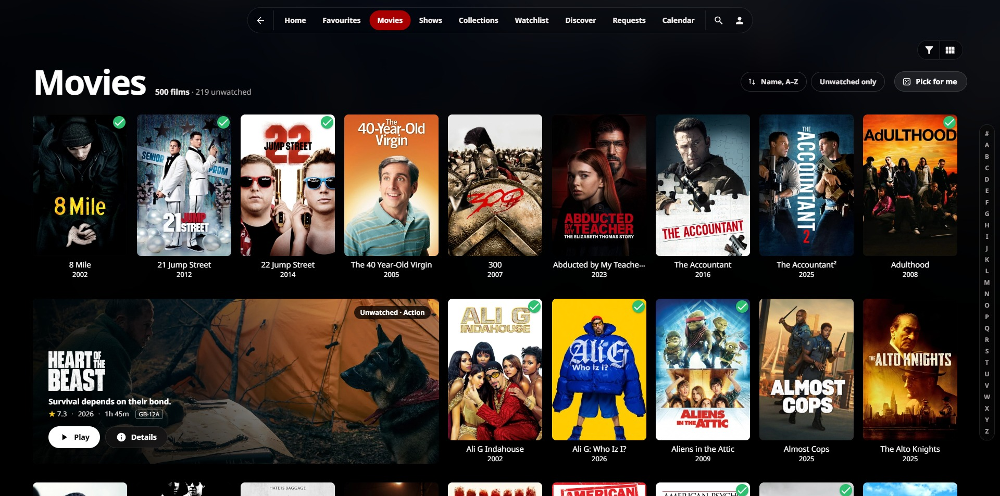
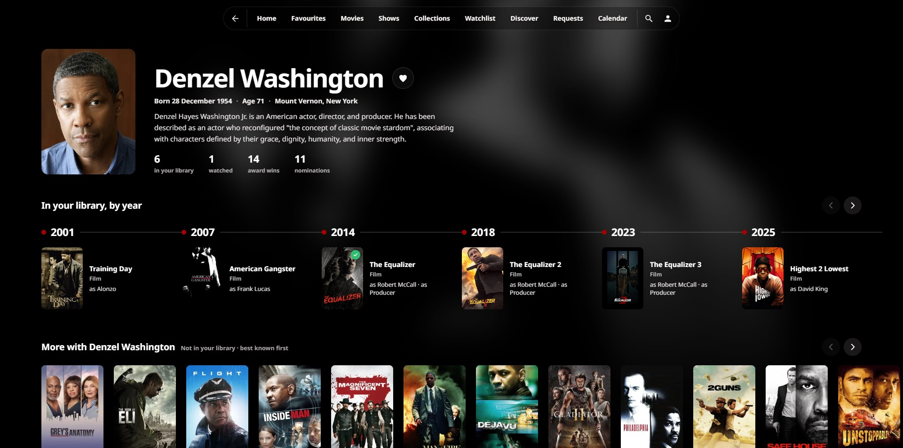

<div align="center">


[](LICENSE)
[](https://github.com/stackinnnn/crimson-noir/releases/latest)
[](https://github.com/stackinnnn/crimson-noir/releases)


A black theme for **Jellyfin 12** that lets your artwork backdrops show through, with an accent colour picker (red by default).<br>
It restyles Jellyfin Web and rebuilds many of its pages, from Home to the video player.

</div>

## Screenshots

<table>
  <tr><td colspan="2"><br><b>Home</b>: a backdrop slideshow you can drag, with logos, ratings and quick actions</td></tr>
  <tr>
    <td width="50%"><br><b>Profile panel</b>: accent colours and quick settings</td>
    <td width="50%"><br><b>Collections</b> as a box-set shelf</td>
  </tr>
  <tr>
    <td><br><b>Seasons</b>: numbered episodes with synopses</td>
    <td><br><b>Libraries</b> with feature tiles</td>
  </tr>
  <tr>
    <td><br><b>People</b>: a career timeline of your library</td>
    <td><br><b>Search</b>: list and preview, plus Jellyseerr results</td>
  </tr>
  <tr>
    <td><br><b>Watchlist</b>: what's ready to watch</td>
    <td><br><b>Calendar</b>: next up and the week ahead</td>
  </tr>
  <tr>
    <td><br><b>Requests</b>: list and detail</td>
    <td></td>
  </tr>
</table>

## Features

- **Black with backdrops**: true-black surfaces, with each title's artwork blurred in behind the page. Each device can switch backdrops on or off.
- **Accent picker**: eight accent colours plus a custom one, set per person from the profile menu.
- **Home**: a full-width slideshow (drag or use the arrows), tidier rows, and a backdrop that follows the slide.
- **Detail pages**: logo-led heroes with ratings, "Ends at", director or creator, and season and episode lists with synopses.
- **Collections** shown as a box-set shelf, and **person pages** as a career timeline.
- **Rebuilt pages**: Search, Settings, Watchlist, Requests and Calendar (the last two need Jellyfin Enhanced).
- **Player**: a cleaner title, a playhead that shows the time, Skip Intro with a countdown, Previous and Up Next buttons, and Playback Info.
- **Metadata on hover** (optional): hide card titles until you point at them.
- **Jellium Desktop support**: the pause screen and Playback Info work in [Jellium](https://github.com/andrewrabert/jellium-desktop).

## Installation

### First make sure you have

- Jellyfin **12.0**
- The **[File Transformation](https://github.com/IAmParadox27/jellyfin-plugin-file-transformation)** plugin. Crimson Noir uses it to add itself to Jellyfin Web. Its repository URL is:
  ```
  https://www.iamparadox.dev/jellyfin/plugins/manifest.json
  ```

### Install from the plugin catalog

1. Open **Dashboard → Plugins → Repositories** (called *Manage Repositories* in some versions).
2. Click **+ / New Repository**, name it `Crimson Noir`, and paste this URL:
   ```
   https://raw.githubusercontent.com/stackinnnn/crimson-noir/main/manifest.json
   ```
   Add the File Transformation repository above the same way if you don't have it yet.
3. Go to **Catalog**, then install **File Transformation** and **Crimson Noir**.
4. **Restart Jellyfin** (Dashboard → Restart), then reload your browser with Ctrl+Shift+R.

Updates appear in the catalog like any other plugin.

### Settings

Go to **Dashboard → Crimson Noir**:

- **Enable the theme**: switch back to stock Jellyfin without uninstalling.
- **Jellium Desktop support**: the mpv bridge for Jellium. It does nothing in other clients.

Each person picks their accent colour, backdrops and "Metadata on hover" from the **profile button** (top right).

### Recommended companions (optional)

| Plugin | Adds |
| --- | --- |
| Jellyfin Enhanced (n00bcodr) | Jellyseerr search results, the **Requests** and **Calendar** pages, pause screen, active streams |
| KefinTweaks (ranaldsgift) | The **Watchlist** tab, the Home/Discover switcher |

Pages that need a missing plugin simply don't appear.

### Moving from a manual install

If you previously pasted Crimson Noir into Jellyfin by hand, remove that copy after installing the plugin, so the theme isn't loaded twice:

- **Dashboard → General → Branding**: clear **Custom CSS**.
- **Dashboard → JavaScript Injector**: disable or delete the `Crimson Noir`, `Slideshow JS` and `Jellium mpv bridge` entries.

<details>
<summary><b>Manual install (without the plugin)</b></summary>

1. Dashboard → General → Branding: paste `css/crimson-noir.css` into **Custom CSS**.
2. Install the [JavaScript Injector](https://github.com/n00bcodr/Jellyfin-JavaScript-Injector) plugin, and add an entry with `js/crimson-noir.js`. Optionally add another with `js/jellium-mpv-bridge.js`.
3. Reload with Ctrl+Shift+R.

</details>

## Compatibility

The theme needs a modern browser engine: CSS `:has()` and `color-mix()` (Chrome/Edge 111+, Safari 16.4+, Firefox 121+). In older engines it **switches itself off**, so you get stock Jellyfin instead of a broken page.

| Client | Status | Notes |
| --- | --- | --- |
| Chrome / Edge | ✅ | Main development browser |
| Firefox / Zen | ✅ | Used with Zen |
| Jellium Desktop | ✅ | Keep **Jellium Desktop support** on |
| Safari 16.4+ (macOS, iOS, iPadOS) | ❔ | Should work: every feature the theme uses is supported. Not tested on a real device yet. |
| Jellyfin Media Player 1.x | ⛔ | Built on Chromium 83, which is too old. It shows stock Jellyfin instead. |
| Android / iOS apps, TV apps | ❔ | Not tested |

## Reporting bugs and ideas

Open an [issue](../../issues/new/choose). The form asks for the page, the client, the steps to reproduce, any console errors (F12 → Console) and a screenshot.

## Development

```
css/crimson-noir.css          the theme's styles
js/crimson-noir.js            the theme script
js/crimson-noir-guard.js      switches the theme off in browser engines that are too old
js/jellium-mpv-bridge.js      Jellium Desktop support
js/slideshow.js               older build, kept for manual installs that still use it
src/Jellyfin.Plugin.CrimsonNoir/   the plugin (embeds the files above)
scripts/pull.ps1, push.ps1    sync css/ and js/ with a live server's manual install
```

- **Build**: every push compiles the plugin on GitHub Actions (the *Build* workflow). The built DLL is attached to each run.
- **Release**: go to **Actions → Release → Run workflow** and enter a version (e.g. `1.0.1.0`) and what changed. The workflow builds the zip, publishes a GitHub release and adds it to `manifest.json`, so servers see the update in their catalog.
- **Sync scripts** (for a manual install only; they refuse to run against a server that has the plugin): copy `scripts/config.example.json` to `scripts/config.local.json` and add your server URL and an API key. Then `.\scripts\pull.ps1` copies what's live into the repo, and `.\scripts\push.ps1 [-DryRun]` uploads your changes. It saves a backup first.

The history before November 16 2026 was rebuilt from dated theme backups.

## Credits

- Plugin structure and the File Transformation approach adapted from [SleekFin](https://github.com/varunaditya-plus/SleekFin) by varunaditya-plus (MIT). Jellyfin 12 page hooks were also informed by SleekFin.
- [File Transformation](https://github.com/IAmParadox27/jellyfin-plugin-file-transformation) by IAmParadox27.
- Works alongside Jellyfin Enhanced and JavaScript Injector by n00bcodr, and KefinTweaks by ranaldsgift.

## Licence

[MIT](LICENSE)
