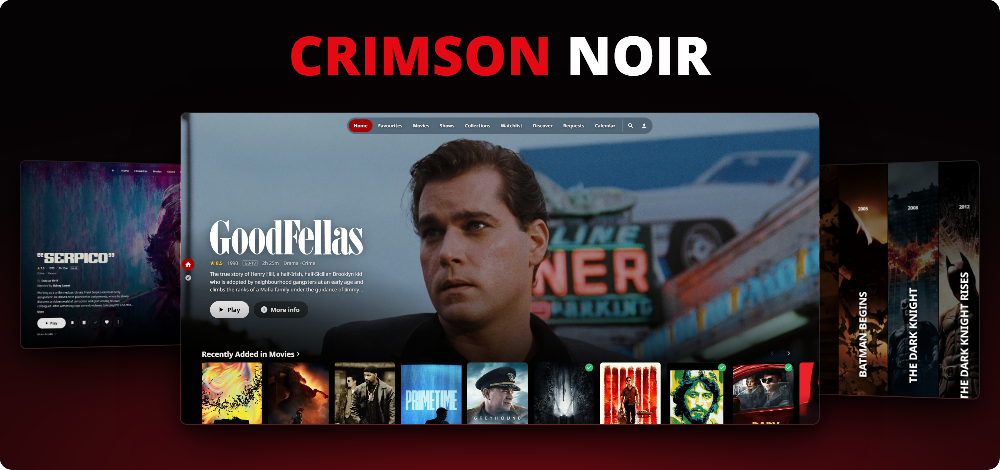
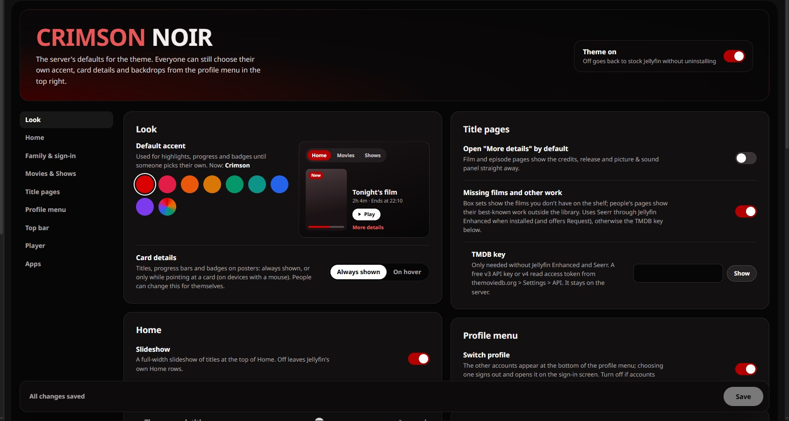
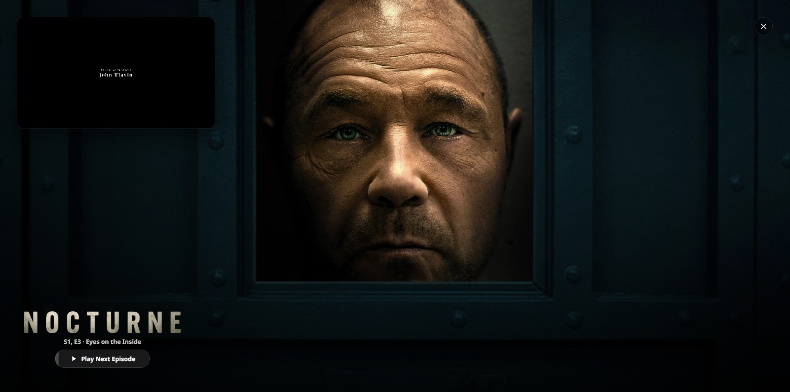
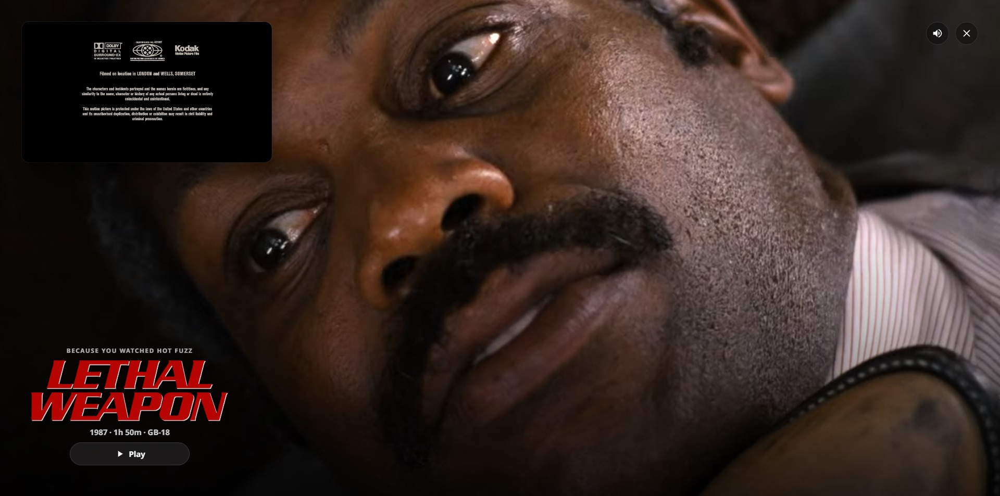

<div align="center">



A black theme for **Jellyfin 12** that lets every title's artwork fill the screen.

[](https://github.com/stackinnnn/crimson-noir/releases/latest)
[](https://github.com/stackinnnn/crimson-noir/releases)

[](LICENSE)

</div>

<table>
<tr>
<td width="33%" valign="top"><b>Artwork first</b><br>Black surfaces and blurred backdrops, so the film does the talking.</td>
<td width="33%" valign="top"><b>Whole pages rebuilt</b><br>Home, film pages, the player, collections, people, search and more.</td>
<td width="33%" valign="top"><b>Your accent</b><br>Eight colours or your own, chosen per person.</td>
</tr>
</table>

**Install:** in **Dashboard → Plugins → Repositories**, add this URL and the [File Transformation](https://github.com/IAmParadox27/jellyfin-plugin-file-transformation) repository, install both from **Catalog**, then restart Jellyfin. [Full steps](#install)

```
https://raw.githubusercontent.com/stackinnnn/crimson-noir/main/manifest.json
```

## Features

### Designed around your artwork

Near-black surfaces everywhere, so the posters and backdrops carry the colour. Titles appear as their logos, backdrops fade in behind the page you're on, and a floating navigation pill gives every library its own tab. One accent colour ties the buttons, toggles and highlights together; nothing else competes with the film.

### Pick your accent

Eight accents (**Crimson**, **Rose**, **Ember**, **Amber**, **Emerald**, **Teal**, **Azure**, **Violet**) or any colour you choose with the custom picker. Each person picks their own from the profile button, and text on the accent stays readable whichever colour you choose.

### Quick settings, one click away

The profile button opens a panel with the settings people actually change:

- **Metadata:** always shown, or only when you hover. Cards stay clean posters until you point at them; watched ticks and episode counts stay visible.
- **Backdrops:** on or off.
- **Autoplay next** episode, and **Remember tracks** for audio and subtitles.
- **Languages** for subtitles and audio, and which **audio track** plays first: the film's default or your language.


### Safe to try, set up in one place

In a browser that's too old, the theme switches itself off and you get stock Jellyfin instead of a broken page. Everything server-wide lives on one settings page in *Dashboard → Plugins → Crimson Noir*: the default accent, the Home slideshow, feature tiles, the end screen and more, plus one switch that turns the theme off for everyone without uninstalling.

<a href="docs/screenshots/14-settings.jpg"></a>

## Page by page

### Watching

<a href="docs/screenshots/04-film-details.jpg"></a>

**Film pages.** The title logo over full-screen artwork, with rating, runtime, ends-at time and director. *Ratings need Jellyfin Enhanced.*

<table>
<tr>
<td width="50%" valign="top"><a href="docs/screenshots/16-end-screen-episode.jpg"></a><br><b>Up next</b><br>When the credits roll, the next episode takes over; the credits play on in the corner.</td>
<td width="50%" valign="top"><a href="docs/screenshots/17-end-screen-film.jpg"></a><br><b>Something like it</b><br>After a film, a similar one with its trailer behind. <i>Trailers come from YouTube; one switch turns them off.</i></td>
</tr>
</table>

### Browsing

<a href="docs/screenshots/05-collection-shelf.jpg"></a>

**Collections.** A box set becomes a shelf of spines beside the chosen film's backdrop, with every film in a grid below. Films you don't have yet appear greyed out, ready to request. *Requests need Jellyfin Enhanced and Seerr.*

<table>
<tr>
<td width="50%" valign="top"><a href="docs/screenshots/07-movies-library.jpg"></a><br><b>Libraries</b><br>Feature tiles among the posters, a sort menu, Unwatched only, Pick for me, A–Z and page numbers. Collections get the same.</td>
<td width="50%" valign="top"><a href="docs/screenshots/08-person-page.jpg"></a><br><b>People and studios</b><br>A career timeline, by year, and what else they've made. Studios and networks get a page of their own too.</td>
</tr>
<tr>
<td width="50%" valign="top"><a href="docs/screenshots/09-search.jpg"></a><br><b>Search</b><br>A list with a large preview. <i>Jellyseerr needs Jellyfin Enhanced.</i></td>
<td width="50%" valign="top"><a href="docs/screenshots/11-calendar.jpg"></a><br><b>Calendar</b><br>Next up and the week ahead. <i>Needs Jellyfin Enhanced.</i></td>
</tr>
</table>

### Yours

<table>
<tr>
<td width="50%" valign="top"><a href="docs/screenshots/10-watchlist.jpg"></a><br><b>Watchlist</b><br>What's ready to watch. <i>Needs KefinTweaks.</i></td>
<td width="50%" valign="top"><a href="docs/screenshots/12-requests.jpg"></a><br><b>Requests</b><br>Every request and its status. <i>Needs Jellyfin Enhanced.</i></td>
</tr>
</table>

## Install

**Before you start:** you need Jellyfin **12**. Crimson Noir adds itself to Jellyfin Web through the **File Transformation** plugin, which you install alongside it below. Optional: **Jellyfin Enhanced** (Calendar, Requests, Jellyseerr search) and **KefinTweaks** (Watchlist); pages whose plugin isn't installed simply don't appear.

1. Open **Dashboard → Plugins → Repositories** and add two repositories:
   - Name `File Transformation`, URL:
     ```
     https://www.iamparadox.dev/jellyfin/plugins/manifest.json
     ```
   - Name `Crimson Noir`, URL:
     ```
     https://raw.githubusercontent.com/stackinnnn/crimson-noir/main/manifest.json
     ```
2. In **Catalog**, install **File Transformation** and **Crimson Noir**.
3. **Restart Jellyfin**, then reload your browser with <kbd>Ctrl</kbd>+<kbd>Shift</kbd>+<kbd>R</kbd>.

Updates arrive through the catalog like any other plugin.

**Settings.** *Dashboard → Crimson Noir* has two switches: **Enable the theme** (back to stock Jellyfin without uninstalling) and **Jellium Desktop support**. Each person picks their accent colour, backdrops and "titles on hover" from the profile button, top right.

<details>
<summary><b>Moving from a manual install</b></summary>

If you pasted Crimson Noir into Jellyfin by hand before, remove that copy after installing the plugin so the theme doesn't load twice:

- **Dashboard → General → Branding**: clear **Custom CSS**.
- **Dashboard → JavaScript Injector**: disable or delete the `Crimson Noir`, `Slideshow JS` and `Jellium mpv bridge` entries.

</details>

<details>
<summary><b>Manual install (without the plugin)</b></summary>

1. **Dashboard → General → Branding**: paste `css/crimson-noir.css` into **Custom CSS**.
2. Install the [JavaScript Injector](https://github.com/n00bcodr/Jellyfin-JavaScript-Injector) plugin and add an entry with `js/crimson-noir.js`. Add `js/jellium-mpv-bridge.js` too if you use Jellium Desktop.
3. Reload with <kbd>Ctrl</kbd>+<kbd>Shift</kbd>+<kbd>R</kbd>.

</details>

## Compatibility

The theme needs a modern browser engine, with CSS `:has()` and `color-mix()`: Chrome or Edge 111+, Safari 16.4+, Firefox 121+. In anything older it **switches itself off**, so you get working stock Jellyfin instead of a broken page.

| Client | Status | Notes |
| --- | --- | --- |
| Chrome, Edge | **Works** | Main development browser |
| Firefox, Zen | **Works** | Used with Zen |
| [Jellium Desktop](https://github.com/andrewrabert/jellium-desktop) | **Works** | Keep *Jellium Desktop support* on. Menus use smoked glass, because mpv's picture can't be blurred. |
| Safari 16.4+ (macOS, iOS, iPadOS) | Untested | Every feature it uses is supported; not yet checked on a device |
| Jellyfin Media Player 1.x | Stock look | Its Chromium 83 engine is too old, so it shows stock Jellyfin |
| Jellyfin for Android and iOS (phone apps) | Emulated | These apps show your server's web interface, so they get the theme. Checked at phone size with Jellyfin's mobile layout (Home, shows, libraries, search, profile panel); not yet on a real phone. iOS needs iOS 16.4+. |
| webOS and Tizen TVs | Emulated | These run the web interface in Jellyfin's TV layout. Checked at 1920×1080: pages scale up cleanly. Remote (D-pad) navigation not yet tried on a real TV. |
| Android TV app, Swiftfin, Findroid, Roku | No theme | Fully native apps; they don't use the web interface, so web themes can't reach them. |

**Bugs and ideas:** [open an issue](../../issues/new/choose). The form asks for the page, your client, the steps, any console errors (F12 → Console) and a screenshot.

## Development

```
css/crimson-noir.css              the theme's styles
js/crimson-noir.js                the theme script
js/crimson-noir-guard.js          switches the theme off in browser engines that are too old
js/jellium-mpv-bridge.js          Jellium Desktop support
js/slideshow.js                   older build, kept for manual installs that still use it
src/Jellyfin.Plugin.CrimsonNoir/  the plugin, which embeds the files above
scripts/pull.ps1, push.ps1        sync a manual install (they refuse servers running the plugin)
scripts/dev.cmd, dev-kefin.cmd    try this copy in Jellium Desktop against your own server, nothing released
scripts/screens.cmd               screenshot check: the released theme and this copy, side by side
CHANGELOG.md                      what changed in each release
```

- **Try changes before releasing:** close Jellium Desktop, then run `scripts\dev.cmd`. Jellium opens with the theme served from `js/` and `css/` (a red "Local theme" tag shows it). Edit, press Ctrl+R, and you see the change. `dev-kefin.cmd` also switches on KefinTweaks' breadcrumbs, season flattening and series info in that window only. Close the dev window to go back to the released theme.
- **Before a release:** run `scripts\screens.cmd` (with dev.cmd closed). It photographs 15 pages with the released theme and with this copy, then opens `screenshots-check\<date>\compare.html` with them side by side. The screenshots stay on your PC.
- **Build:** every push compiles the plugin and syntax-checks the scripts on GitHub Actions.
- **Release:** go to **Actions → Release → Run workflow**, then enter a version (e.g. `1.0.3.0`) and what changed. It builds the zip, publishes the release and adds it to `manifest.json`, so servers see the update in their catalog.
- The history before 16 November 2026 was rebuilt from dated theme backups.

## Credits

- Plugin structure and the File Transformation approach adapted from [SleekFin](https://github.com/varunaditya-plus/SleekFin) by varunaditya-plus (MIT), which also informed the Jellyfin 12 page hooks.
- [File Transformation](https://github.com/IAmParadox27/jellyfin-plugin-file-transformation) by IAmParadox27.
- Works alongside Jellyfin Enhanced and JavaScript Injector by n00bcodr, and KefinTweaks by ranaldsgift.

Released under the [MIT licence](LICENSE).
