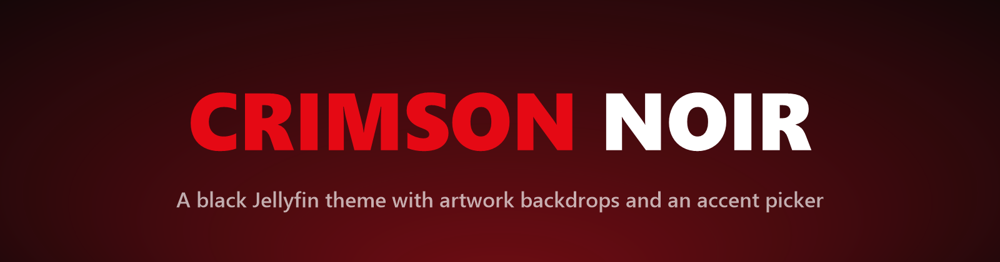
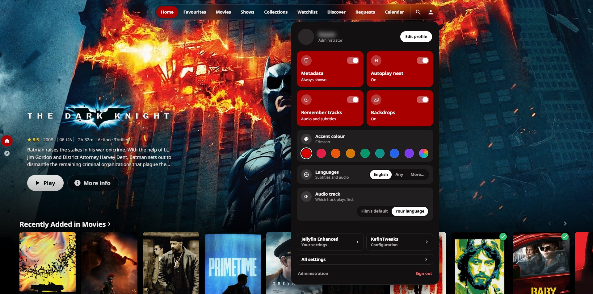
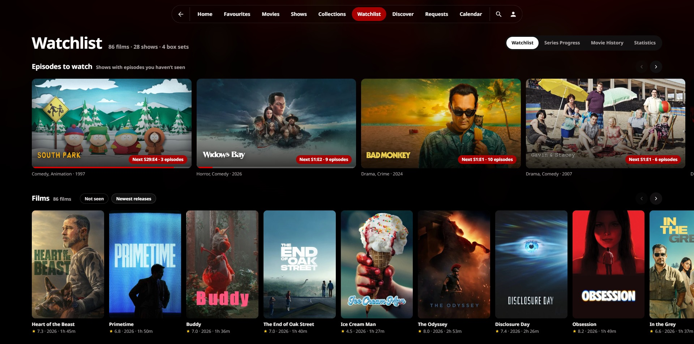
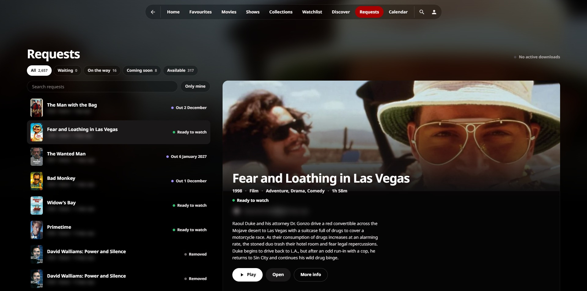

<div align="center">



A black theme for **Jellyfin 12** that lets your artwork show through, with an accent colour picker.<br>
It restyles Jellyfin Web and rebuilds its pages, from Home to the video player.

[](https://github.com/stackinnnn/crimson-noir/releases/latest)

[](LICENSE)

[Now showing](#now-showing-home) &nbsp;·&nbsp; [Scenes](#scenes-every-page-rebuilt) &nbsp;·&nbsp; [**Admission (install)**](#admission-install-from-the-plugin-catalog) &nbsp;·&nbsp; [Running notes](#running-notes-compatibility) &nbsp;·&nbsp; [End credits](#end-credits)

</div>

## Now showing: Home


A slideshow you can drag, a backdrop that follows the slide, and your accent colour throughout. Everything stays black, so the artwork does the talking.

## Scenes: every page, rebuilt

<table>
  <tr>
    <td width="58%"></td>
    <td><b>The player</b><br><br>Pause and the picture dims behind the show's logo. Clean episode titles, a playhead that shows the time, Skip Intro with a countdown, and Previous / Up Next.</td>
  </tr>
  <tr>
    <td><b>Your accent, your settings</b><br><br>The profile button opens quick settings: eight accent colours or your own, backdrops on or off, and titles that only appear on hover.</td>
    <td width="58%"></td>
  </tr>
  <tr>
    <td></td>
    <td><b>Collections, on a shelf</b><br><br>Box sets open as a row of spines. Pick a film and its backdrop, logo and details take the stage.</td>
  </tr>
  <tr>
    <td><b>Seasons with synopses</b><br><br>Numbered episodes with stills, runtime, rating, air date and a two-line synopsis, plus a watched toggle on every row.</td>
    <td></td>
  </tr>
  <tr>
    <td></td>
    <td><b>Libraries with feature tiles</b><br><br>Movies, Shows and Collections get a clear title and count, and wide feature tiles (unwatched picks, top genres) break up the grid.</td>
  </tr>
  <tr>
    <td><b>People as a career timeline</b><br><br>Portrait, age and birthplace, awards, and everything they've made that's in your library, laid out by year.</td>
    <td></td>
  </tr>
  <tr>
    <td></td>
    <td><b>Search: list and preview</b><br><br>Results from your library and from Jellyseerr side by side, with a large preview and a Request button for anything you don't have.</td>
  </tr>
  <tr>
    <td><b>Watchlist: ready to watch</b><br><br>Shows with new episodes, films and box sets you've saved, each with Play right on the artwork.</td>
    <td></td>
  </tr>
  <tr>
    <td></td>
    <td><b>Calendar: next up and the week</b><br><br>The next thing to air, large, then the week ahead with episode, cinema and digital releases.</td>
  </tr>
  <tr>
    <td><b>Requests: list and detail</b><br><br>Every Jellyseerr request with its status, and the details for the one you pick.</td>
    <td></td>
  </tr>
</table>

Calendar, Requests and the Jellyseerr parts of Search need **Jellyfin Enhanced**. The Watchlist tab needs **KefinTweaks**. Pages whose plugin isn't installed simply don't appear.

## Admission: install from the plugin catalog

**Before you start**, you need Jellyfin **12** and the **File Transformation** plugin, which Crimson Noir uses to add itself to Jellyfin Web. Its repository is:

```
https://www.iamparadox.dev/jellyfin/plugins/manifest.json
```

1. Open **Dashboard → Plugins → Repositories** and add a repository named `Crimson Noir` with this URL:
   ```
   https://raw.githubusercontent.com/stackinnnn/crimson-noir/main/manifest.json
   ```
2. In **Catalog**, install **File Transformation** (if you haven't) and **Crimson Noir**.
3. **Restart Jellyfin**, then reload your browser with <kbd>Ctrl</kbd>+<kbd>Shift</kbd>+<kbd>R</kbd>.

Updates arrive through the catalog like any other plugin.

**Settings.** *Dashboard → Crimson Noir* has two switches: **Enable the theme** (back to stock Jellyfin without uninstalling) and **Jellium Desktop support**. Each person picks their accent colour, backdrops and "titles on hover" from the profile button, top right.

<details>
<summary><b>Moving from a manual install</b></summary>

If you pasted Crimson Noir into Jellyfin by hand before, remove that copy after installing the plugin so the theme doesn't load twice:

- **Dashboard → General → Branding**: clear **Custom CSS**.
- **Dashboard → JavaScript Injector**: disable or delete the `Crimson Noir`, `Slideshow JS` and `Jellium mpv bridge` entries.

</details>

<details>
<summary><b>Manual install (without the plugin)</b></summary>

1. **Dashboard → General → Branding**: paste `css/crimson-noir.css` into **Custom CSS**.
2. Install the [JavaScript Injector](https://github.com/n00bcodr/Jellyfin-JavaScript-Injector) plugin and add an entry with `js/crimson-noir.js`. Add `js/jellium-mpv-bridge.js` too if you use Jellium Desktop.
3. Reload with <kbd>Ctrl</kbd>+<kbd>Shift</kbd>+<kbd>R</kbd>.

</details>

## Running notes: compatibility

The theme needs a modern browser engine, with CSS `:has()` and `color-mix()`: Chrome or Edge 111+, Safari 16.4+, Firefox 121+. In anything older it **switches itself off**, so you get working stock Jellyfin instead of a broken page.

| Client | Status | Notes |
| --- | --- | --- |
| Chrome, Edge | **Works** | Main development browser |
| Firefox, Zen | **Works** | Used with Zen |
| [Jellium Desktop](https://github.com/andrewrabert/jellium-desktop) | **Works** | Keep *Jellium Desktop support* on. Menus use smoked glass, because mpv's picture can't be blurred. |
| Safari 16.4+ (macOS, iOS, iPadOS) | Untested | Every feature it uses is supported; not yet checked on a device |
| Jellyfin Media Player 1.x | Stock look | Its Chromium 83 engine is too old, so it shows stock Jellyfin |
| Android, iOS and TV apps | Untested | |

**Bugs and ideas:** [open an issue](../../issues/new/choose). The form asks for the page, your client, the steps, any console errors (F12 → Console) and a screenshot.

## Behind the scenes

```
css/crimson-noir.css              the theme's styles
js/crimson-noir.js                the theme script
js/crimson-noir-guard.js          switches the theme off in browser engines that are too old
js/jellium-mpv-bridge.js          Jellium Desktop support
js/slideshow.js                   older build, kept for manual installs that still use it
src/Jellyfin.Plugin.CrimsonNoir/  the plugin, which embeds the files above
scripts/pull.ps1, push.ps1        sync a manual install (they refuse servers running the plugin)
```

- **Build:** every push compiles the plugin and syntax-checks the scripts on GitHub Actions.
- **Release:** go to **Actions → Release → Run workflow**, then enter a version (e.g. `1.0.3.0`) and what changed. It builds the zip, publishes the release and adds it to `manifest.json`, so servers see the update in their catalog.
- The history before 16 November 2026 was rebuilt from dated theme backups.

## End credits

- Plugin structure and the File Transformation approach adapted from [SleekFin](https://github.com/varunaditya-plus/SleekFin) by varunaditya-plus (MIT), which also informed the Jellyfin 12 page hooks.
- [File Transformation](https://github.com/IAmParadox27/jellyfin-plugin-file-transformation) by IAmParadox27.
- Works alongside Jellyfin Enhanced and JavaScript Injector by n00bcodr, and KefinTweaks by ranaldsgift.

Released under the [MIT licence](LICENSE).
