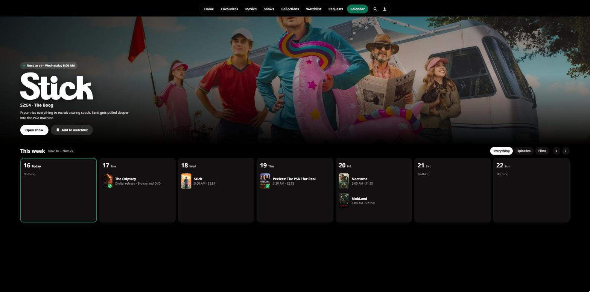

# Crimson Noir

A black theme for **Jellyfin 12** that lets your artwork backdrops show through, with an accent colour picker (red by default). It restyles the web client and rebuilds several pages: Home with a backdrop slideshow, detail pages, collections as a box-set shelf, search, settings, the watchlist, requests, the calendar, person pages and the video player.


## Screenshots

| | |
| --- | --- |
| <br>**Accent picker** in the profile panel | <br>**Collections** as a box-set shelf |
| <br>**Season pages** with numbered episodes and synopses | <br>**Libraries** with feature tiles and backdrops |
| <br>**Person pages** as a career timeline | <br>**Search** with a list and preview, including Jellyseerr results |
| <br>**Watchlist**: what's ready to watch | <br>**Calendar**: next up and the week |
| <br>**Requests**: list and detail | |

## What's in this repo

| File | Where it goes | What it does |
| --- | --- | --- |
| `css/crimson-noir.css` | Dashboard → General → Branding → **Custom CSS** | All the theme's styling |
| `js/crimson-noir.js` | JavaScript Injector entry **"Crimson Noir"** | The theme script: page rebuilds, Home slideshow, player tweaks and the profile quick-settings panel |
| `js/jellium-mpv-bridge.js` | JavaScript Injector entry **"Jellium mpv bridge"** (optional) | Makes the pause screen, paused player bar and Playback Info work in [Jellium Desktop](https://github.com/andrewrabert/jellium-desktop), which plays video through native mpv. It does nothing in a normal browser. |
| `js/slideshow.js` | JavaScript Injector entry **"Slideshow JS"** (legacy) | An older, smaller build of the theme. Both scripts share the `window.__crimsonNoir` guard, so only the first one to load runs. New installs don't need it. |
| `scripts/` | – | `pull.ps1` and `push.ps1` sync these files with a live server (see below) |

## Requirements

- Jellyfin **12** (web client)
- [JavaScript Injector](https://github.com/n00bcodr/Jellyfin-JavaScript-Injector) plugin

These plugins are optional. The pages that rely on them simply don't appear without them:

- **Jellyfin Enhanced** (n00bcodr): Jellyseerr search results, the Requests and Calendar pages, the pause screen, active streams
- **KefinTweaks** (ranaldsgift): the Watchlist tab, the Home/Discover rail

## Install

1. Dashboard → General → Branding: paste `css/crimson-noir.css` into **Custom CSS** and save.
2. Dashboard → Plugins → JavaScript Injector: add an entry named `Crimson Noir`, paste `js/crimson-noir.js`, enable it and save.
3. (Optional, for Jellium Desktop) add an entry named `Jellium mpv bridge` containing `js/jellium-mpv-bridge.js`.
4. Hard-refresh the browser (Ctrl+Shift+R).

## Reporting bugs

Open an [issue](../../issues/new/choose) and include:

- the page or route (e.g. `#/details?id=…`, `#/video`)
- the client (browser and version, Jellium Desktop, a TV app…)
- a screenshot and any console errors (F12 → Console)

## Maintaining (sync with a live server)

The server is the source of truth for what's running. The scripts use the Jellyfin API with an API key.

One-time setup:

1. Dashboard → API Keys → **+**, and name it `crimson-noir repo`.
2. Copy `scripts/config.example.json` to `scripts/config.local.json` and fill in `server` and `apiKey`. This file is git-ignored.

Day to day:

```powershell
# Snapshot what's live into the repo, then commit it
.\scripts\pull.ps1
git add -A; git commit -m "Describe the change"

# Or edit here, then upload. Changed files only; the server's current
# copy is saved to backups\ first.
.\scripts\push.ps1            # add -DryRun to preview
```

After a CSS push, browsers pick up the new CSS on their next page load: the theme refreshes Jellyfin's cached branding CSS itself.

Commits before this repo existed were rebuilt from dated theme backups taken between 10 and 16 Nov 2026. Each commit is named after the change it introduced.

## Credits

Jellyfin 12 page hooks were informed by SleekFin by varunaditya-plus (MIT).

## Licence

[MIT](LICENSE)
